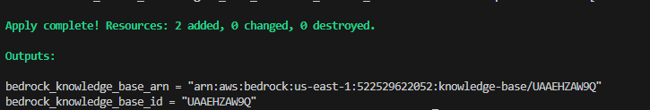

# AWS Bedrock Knowledge Base with Aurora Serverless


## Project Structure
```bash
├── stack1/                 # Infrastructure Foundation
│   ├── main.tf             # VPC, Aurora Cluster, S3 Bucket
├── stack2/                 # GenAI Layer
│   ├── main.tf             # Bedrock Knowledge Base configuration
├── modules/                # Reusable Terraform Modules
│   ├── database/           # Aurora Serverless module
│   └── bedrock_kb/         # Bedrock Knowledge Base module
├── scripts/
│   ├── aurora_sql.sql      # Database schema & vector extension setup
│   └── upload_to_s3.py     # Document ingestion script
├── app.py                  # Streamlit Chat Interface
├── bedrock_utils.py        # Boto3 logic for RAG & validation
└── requirements.txt        # Python dependencies
```

## Overview
This project implements a scalable **Retrieval-Augmented Generation (RAG)** system on AWS. leveraging **Amazon Bedrock** for foundation models and **Amazon Aurora Serverless v2 (PostgreSQL)** as a high-performance vector database. It provides an interactive chat interface where users can query a knowledge base of documents, with the system retrieving relevant context to generate accurate, source-backed responses.

The infrastructure is fully provisioned using **Terraform**, demonstrating a production-ready approach to cloud-native generative AI applications.

## Business Use Case
**Scenario:** A heavy machinery manufacturer faces downtime issues due to field technicians struggling to find specific maintenance procedures in thousands of pages of PDF manuals.

**Solution:** This RAG application serves as an **AI-Powered Field Assistant**. Technicians can ask natural language questions like *"How do I recalibrate the hydraulic pump on the X-2000 excavator?"*. The system retrieves the exact page from the uploaded manuals and generates a step-by-step summary, reducing diagnostic time and equipment downtime.

## Key Features
- **Serverless Vector Storage**: Utilizes Aurora Serverless v2 with `pgvector` for efficient, scalable vector similarity search without managing database instances.
- **Managed RAG Pipeline**: Integrates Amazon Bedrock Knowledge Bases to handle the complexity of embedding generation and retrieval.
- **Infrastructure as Code (IaC)**: Complete modular Terraform setup for VPC, Database, S3, and IAM roles, ensuring reproducibility.
- **Interactive Chat UI**: A user-friendly Streamlit application that supports model selection (Claude 3 Haiku/Sonnet) and parameter tuning.
- **Secure Architecture**: Implements least-privilege IAM roles and deployed within a VPC for data security.

## Technology Stack
- **Cloud Provider**: AWS (Region: `us-east-1`)
- **Infrastructure as Code**: Terraform (Modules for VPC, RDS, Bedrock)
- **Generative AI**:
  - **Models**: Anthropic Claude 3 (Haiku, Sonnet), Amazon Titan Embeddings
  - **Service**: Amazon Bedrock Agents & Knowledge Bases
- **Database**: Amazon Aurora Serverless v2 (PostgreSQL compatible)
  - **Extensions**: `vector` (pgvector)
- **Application**: Python 3.10+, Streamlit, Boto3

## Implementation Summary
The deployment follows a multi-stage approach to ensure dependency management:
1.  **Stack 1 (Foundation)**: Deploys the VPC networking and the Aurora Serverless cluster. It also provisions the S3 bucket for storing source documents (e.g., PDFs).

<p align="center">
  
  <br>
  terraform apply output and RDS secret created
</p>

2.  **Database Preparation**: Executes SQL scripts to enable the `vector` extension and create the `bedrock_integration` schema and tables with appropriate HNSW and GIN indexes.
3.  **Stack 2 (Knowledge Base)**: Configures the Bedrock Knowledge Base to connect the S3 data source with the Aurora vector store, mapping fields for embeddings and metadata.

<p align="center">
  
  <br>
  terraform apply output stack2
</p>

4.  **Application**: A Python app that validates prompts (filtering out unrelated queries) and orchestrates the *Retrieve* and *Generate* steps using the Boto3 Bedrock Runtime client.

<p align="center">
  
  <br>
  valid prompt function
</p>

<p align="center">
  
  <br>
  Final Deployed App
</p>


## Takeaways
-   **Region Consistency**: A critical lesson was ensuring all services (Bedrock models, S3 buckets, and RDS instances) reside in the same region. Deploying infrastructure in `us-east-1` while referencing models in `us-west-2` leads to validation failures.
-   **Vector Indexing Strategies**: Standard B-tree indexes are insufficient for vector search. Implementing **HNSW (Hierarchical Navigable Small World)** indexes significantly improves vector search capability, while **GIN (Generalized Inverted Index)** is essential for filtering metadata and text chunks.
-   **Prompt Engineering Validation**: Implementing a pre-validation step (using a lightweight model like Claude Haiku) to classify requests prevents misuse and ensures the LLM stays on topic (e.g., focusing only on "heavy machinery").
-   **Serverless Database Behavior**: Understanding the scaling behavior of Aurora Serverless v2 is crucial for cost optimization in sporadic workload scenarios like a knowledge base assistant.
-   **IaC State Management**: Managing dependencies between separate Terraform stacks (passing outputs from Stack 1 to Stack 2) mimics real-world enterprise environments where infrastructure requires layered deployments.
-   **End-to-End RAG**: Building a RAG system from scratch—from infrastructure provisioning to frontend logic—provided deep visibility into the "plumbing" of Generative AI applications often abstracted away by high-level frameworks.
